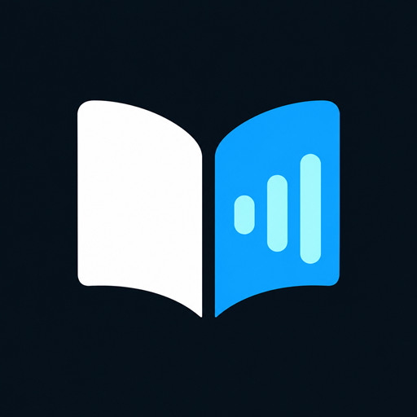

<p align="center">
  
</p>

<h1 align="center">DhebeVoice</h1>
<p align="center"><strong>Long-form reading, aloud.</strong><br>Turn text, books, and readable web pages into your listening queue.</p>

<p align="center">
  
  
  
  
</p>

<p align="center">
  <a href="https://play.google.com/store/apps/details?id=com.dhebe.dhebevoice">Google Play</a> |
  <a href="#features">Features</a> |
  <a href="docs/READER_GUIDE.md">Reader guide</a> |
  <a href="docs/DEVELOPMENT.md">Development</a> |
  <a href="CHANGELOG.md">Changelog</a> |
  <a href="https://github.com/DattaDhebe/dhebevoice-app/issues/new/choose">Report an issue</a>
</p>

DhebeVoice is an Android text-to-speech reader built with Flutter and Kotlin. Listen to pasted text, TXT, EPUB, PDF, and supported web pages, keep a local Book List, and continue through chapters with paragraph-aware controls. Use your installed Android voices or download the optional Supertonic 3 pack for on-device neural narration. DhebeVoice does not require a paid TTS API key.

> **Availability:** The app is in Google Play closed testing; the Play link may require tester access. This repository can contain changes newer than the installed Play build. See the [changelog](CHANGELOG.md) for the distinction.

## Preview

<table>
  <tr>
    <th>Read and listen</th>
    <th>Keep your books</th>
    <th>Personalize playback</th>
  </tr>
  <tr>
    <td></td>
    <td></td>
    <td></td>
  </tr>
</table>

Screenshots show an earlier app build; current controls and voice selection have evolved.

## Features

| Area | What you can do |
| --- | --- |
| Import | Paste text, open TXT/EPUB/text-based PDF files, or share a readable web link from your browser. Review shared links before starting an import. |
| Library | Keep imported books locally, search books and chapters, reopen saved reading positions, and delete books with confirmation. A removable sample book helps first-time users. |
| Reader | Open full reading views, highlight the current passage, play from selected text or a paragraph, and jump to nearby paragraphs or chapters. |
| Playback | Use persistent Play/Pause/Stop controls, chapter continuation, notification and lock-screen media controls, Bluetooth controls, and a sleep timer. |
| Voice choice | Browse searchable avatar cards, full language/region names, and engine-provided quality and offline/online information. |
| Neural narration | Download Supertonic 3, generate speech on-device, see preparation progress, and choose background preloading or optional whole-chapter preparation. |
| Appearance | Choose light, dark, or follow-device themes. Layout tests cover small screens, large text, and the keyboard. |

## Speech Engines

| | Installed Android TTS | Supertonic 3 |
| --- | --- | --- |
| Setup | Default; uses your phone's installed engine and voices | Optional model download, about 402 MB; allow at least 850 MB free space |
| Voice choice | Depends on the installed provider, language packs, and device | Ten narrators across 31 supported languages, including English and Hindi |
| Processing | Offline or online, as reported by the provider | On-device inference through ONNX Runtime |
| Internet | Required for online voices; selection asks for consent | Required to download the model, not to synthesize after installation |
| Cost and terms | No paid cloud API integration in DhebeVoice; provider terms and data charges still apply | No paid API; OpenRAIL-M model restrictions and bundled license notices apply |

Android does not provide a standard voice-gender field. Cards show Female, Male, or Child when the provider supplies a recognizable label, otherwise **Gender not provided**. Select a voice and use the label icon to save your own local type label without changing the sound or interrupting playback. Friendly display names never replace the engine's actual voice ID.

Voice and language changes take effect at the next speech segment. Changing language changes pronunciation, **not** the written text. Neural generation can still be slower than playback on some phones; buffering and changes in delivery between segments remain possible. See [speech behavior and limits](docs/SPEECH_AND_IMPORTS.md).

## Start Listening

1. Paste text, import a supported file, or share a web link into DhebeVoice.
2. For a shared link, review it and press **Start import**. Closing the progress popup does not stop downloading; **Stop import** does.
3. Open a book or chapter, choose an installed voice, and press **Play**. Use paragraph selection to begin elsewhere.
4. Optionally download Supertonic 3 in Settings and select it under Speech engine.

See the [reader guide](docs/READER_GUIDE.md) for voice labeling, import recovery, background playback, and common limitations.

## Privacy and Content

Books and reading positions are stored locally. Optional neural synthesis runs on the device. Web imports contact the source website, model downloads contact the model host, and online Android voices may send reading text to their provider after consent. Device-engine behavior and provider terms still apply.

Import only content you own, are licensed to access, or that is in the public domain. The app does not host books, grant copyright permissions, bypass paywalls, or bypass website access restrictions. Text-based PDF extraction is supported; scanned-image OCR is not.

## For Developers

Validated locally with Flutter 3.41.9 / Dart 3.11.5. Android is the actively tested target; other generated platform directories are not a promise of feature parity.

```bash
git clone https://github.com/DattaDhebe/dhebevoice-app.git
cd dhebevoice-app
flutter pub get
flutter analyze
flutter test
flutter run -d <android-device-id>
```

Use the separate **DhebeVoice Test** build to avoid modifying a Play-installed app's books and settings. Read [development and release setup](docs/DEVELOPMENT.md), the [architecture map](docs/ARCHITECTURE.md), and [contribution guidance](CONTRIBUTING.md) before changing playback or imports. Release signing credentials and model downloads must stay outside Git.

## Related Work

DhebeVoice focuses on the application and listening experience. The author's separate speech-model projects are [tts_humanize](https://github.com/DattaDhebe/tts_humanize) and [personal-voice-tts](https://github.com/DattaDhebe/personal-voice-tts). They are not paid cloud services or bundled replacements for the engines listed above.

## Licensing

This repository currently has no project-wide license file; do not assume that its source is MIT- or Apache-licensed. Third-party code and model terms remain separate. Bundled notices are in [assets/licenses](assets/licenses) and **Settings > Open-source & voice model licenses**. Supertonic's model uses OpenRAIL-M terms; its upstream repository is archived. Dependency and model licensing must be reviewed before redistribution.
