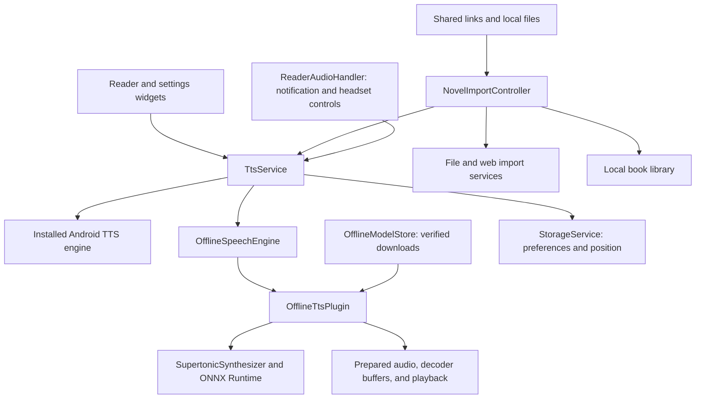

# Architecture

[Overview](../README.md) | [Development](DEVELOPMENT.md)

DhebeVoice keeps reader state and speech transport separate from Flutter views. Android TTS and optional on-device neural synthesis share the reader-facing playback service, while native code owns neural inference and generated-audio resources.

## Source Map

| Path | Responsibility |
| --- | --- |
| [`lib/main.dart`](../lib/main.dart) | App bootstrap, theme/service wiring, and bundled license registration. |
| [`lib/screens`](../lib/screens) | Home reader and Settings surfaces. |
| [`lib/widgets`](../lib/widgets) | Full reading views, transport/status controls, import dialogs, speech preparation, and the searchable voice picker. |
| [`lib/services/tts_service.dart`](../lib/services/tts_service.dart) | Playback session ownership, speech segmentation, voice/language options, interruptions, continuation, and preparation state. |
| [`lib/services/reader_audio_handler.dart`](../lib/services/reader_audio_handler.dart) | Android media controls and shared playback metadata/state. |
| [`lib/services/novel_import_controller.dart`](../lib/services/novel_import_controller.dart) | User-driven import flow, cancellation, partial results, library merge, and current-book preservation. |
| [`lib/services/file_import_service.dart`](../lib/services/file_import_service.dart) | TXT/EPUB/PDF parsing and input limits. |
| [`lib/services/web_novel_import_service.dart`](../lib/services/web_novel_import_service.dart) | Readable HTML extraction, chapter discovery, sequential requests, and web failure handling. |
| [`lib/services/novel_library_service.dart`](../lib/services/novel_library_service.dart) | Local library decoding and serialized file writes. |
| [`lib/services/storage_service.dart`](../lib/services/storage_service.dart) | Preferences, reading position, and engine-scoped voice annotations. |
| [`lib/services/offline_model_store.dart`](../lib/services/offline_model_store.dart) | Optional model download, cancellation, size/hash checks, and readiness. |
| [`lib/services/offline_speech_engine.dart`](../lib/services/offline_speech_engine.dart) | Dart/native bridge for local generation and queued audio. |
| [`android/app/src/main/kotlin/com/dhebe/dhebevoice`](../android/app/src/main/kotlin/com/dhebe/dhebevoice) | Android integration, ONNX inference, temporary audio cache, PCM handling, and decoder handoff. |
| [`test`](../test) | Flutter unit and widget regression tests with mocked platform channels. |
| [`android/app/src/test`](../android/app/src/test) | Native JVM tests and optional verified-model smoke tests. |
| [`android/app/src/androidTest`](../android/app/src/androidTest) | Manually invoked benchmark restricted to the separate Test package. |

## Boundaries to Preserve

- Views render service state; they should not restart narration on every rebuild or lifecycle transition.
- New transport actions supersede stale asynchronous work. Never let a delayed callback undo Stop or restart a paused reader.
- Voice/language changes take effect at a speech boundary; display names and personal type labels must never replace synthesis identities.
- Real progress and indeterminate waits remain distinct. Do not present a made-up completion percentage or guarantee of gapless playback.
- Large file parsing and native inference stay off the UI thread; temporary audio has bounded disk and memory use.
- A web import starts only after user confirmation. Access denials are not retried through an undisclosed bypass service.
- Partial imports and library writes preserve existing chapters and current reading progress.
- Test variants, benchmarks, local credentials, and model files must not leak into release artifacts or Git history.
